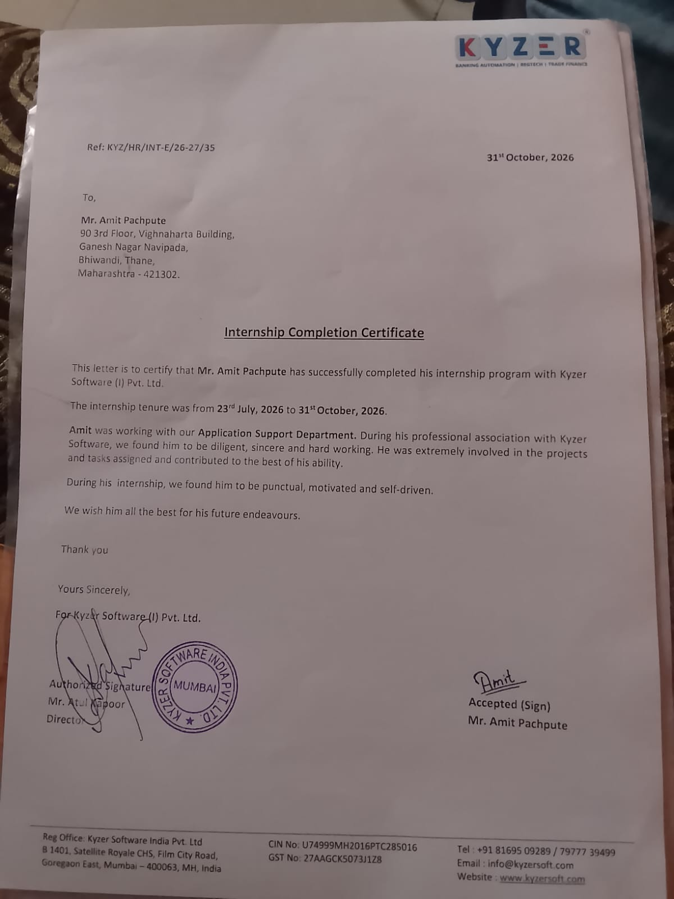

# 🎓 Internship Completion – Kyzer Software Pvt. Ltd.

## Application Support Engineer Intern

I am pleased to share that I have successfully completed my internship as an **Application Support Engineer** at **Kyzer Software Pvt. Ltd.**

During this internship, I gained practical experience in application support, server management, deployment activities, and troubleshooting enterprise banking applications.

### 🛠️ Technical Skills & Technologies

- **Operating System:** Linux
- **Application Server:** Apache Tomcat
- **Database:** MySQL, SQL Server, Oracle
- **Tools:** PuTTY, WinSCP
- **Deployment Environments:** QA, UAT, Pre-Production
- **Technical Skills:** Application Deployment, Issue Analysis, Troubleshooting, Log Monitoring, SQL Queries

### 📚 Key Learnings

- Understanding application support processes.
- Deploying applications across different environments.
- Monitoring application performance and server availability.
- Troubleshooting application-related issues.
- Working with Linux servers and database systems.
- Supporting banking and enterprise applications.

### 📜 Internship Completion Certificate

I am happy to share my internship completion certificate issued by **Kyzer Software Pvt. Ltd.**

### 🙏 Acknowledgement

I sincerely thank Kyzer Software Pvt. Ltd. and the entire team for providing me with this learning opportunity and helping me enhance my technical and professional skills.

---

**Created By:** Amit Pachpute

**Role:** Application Support Engineer Intern

**Company:** Kyzer Software Pvt. Ltd.
